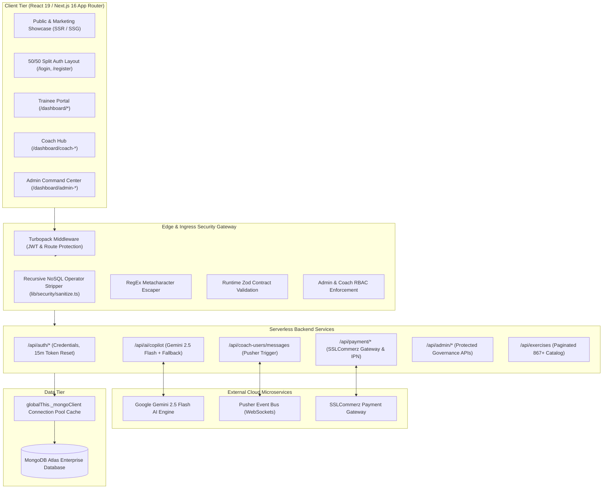

# ⚡ FLEXIFY — Full-Stack AI-Powered Fitness SaaS Platform

<div align="center">


-brightgreen?style=for-the-badge)

<p align="center">
  <strong>An enterprise-grade, multi-tenant fitness SaaS platform connecting Athletes, Certified Coaches, and Administrators in one unified, real-time, AI-augmented ecosystem.</strong>
</p>

[Quick Start Demo](#-1-click-recruiter-quick-start) • [System Architecture](#-system-architecture) • [Engineering Highlights](#-standout-engineering-highlights) • [Feature Matrix](#-multi-role-feature-matrix) • [Local Setup](#-local-development-setup) • [Documentation](docs/PROJECT_BRIEFING.md)

</div>

---

## 📖 What is FLEXIFY?

**FLEXIFY** is a modern SaaS application engineered to address the fragmentation in today's digital fitness landscape. Most fitness apps either offer static, one-size-fits-all exercise routines that fail to adapt to athlete fatigue, or require expensive personal trainers managed through disconnected spreadsheets and messaging channels.

FLEXIFY unifies the experience into an intelligent, multi-tenant platform:
1. **Athletes (Trainees)** receive personalized, daily adaptive workout recommendations powered by **Google Gemini 2.5 Flash**, dynamic rest timers, comprehensive nutrition tracking, 30-day challenge streaks, and direct live communication with certified coaches.
2. **Certified Coaches** access a full remote practice management suite: onboarding trainees, building custom workout and meal regimens, scheduling live video consultations, tracking client compliance, and reviewing monthly revenue earnings.
3. **Platform Administrators** maintain system-wide governance: verifying coach credentials, tracking real-time financial stats and platform subscriptions, managing exercise and content libraries, and broadcasting administrative alerts.

---

## ⚡ 1-Click Recruiter Quick-Start

Recruiters and hiring managers can explore all three platform roles instantly without manual account registration. Simply click the pre-filled demo role buttons on the `/login` screen or use the credentials below:

| Role | Demo Credentials | What Recruiters Will Experience |
| :--- | :--- | :--- |
| **🏋️ Trainee (Athlete)** | `user@flexify.com`<br>`User@Flexify` | • **Adaptive AI Copilot**: Dynamic workout modification based on muscle soreness and energy reserves.<br>• **Interactive Rest Timer**: Audio cues and countdown controls during workout sessions.<br>• **Nutrition Tracker**: Daily macro split breakdown (protein/carbs/fats) and meal logging.<br>• **867+ Exercise Catalog**: Sub-second search, muscle group filtering, and illustrated GIF guides.<br>• **Live Coach Chat**: Instant messaging powered by Pusher real-time event bus. |
| **🥋 Certified Coach** | `coach@flexify.com`<br>`Coach@Flexify1` | • **Trainee Management Hub**: Client roster, fitness update reviews, and progress tracking.<br>• **Workout & Meal Plan Builder**: Custom routine creation assigned directly to clients.<br>• **Session Scheduler**: Booking management with live consultation room links.<br>• **Financial Earnings Ledger**: Detailed monthly revenue breakdown and payment statuses. |
| **🛡️ System Administrator** | `admin@flexify.com`<br>`Admin@Flexify` | • **Platform Command Center**: High-level platform KPIs, gross revenue, and user growth charts.<br>• **Coach Credential Queue**: Verification workflow with instant approval/rejection triggers.<br>• **User & Coach Connect**: Comprehensive directory governance with role assignment.<br>• **Content Management**: Global exercise library CRUD operations and broadcast banners. |

*To re-seed or verify demo credentials in a local environment:*
```bash
npm run seed:demo
```

---

## 🏛️ System Architecture



---

## 🌟 Standout Engineering Highlights

### 1. 100% Component Architecture Decomposition (`< 200` Lines per File)
- **Problem**: Monolithic page components (400-600+ lines) create merge conflicts, sluggish development iteration, and re-rendering inefficiencies.
- **Engineering Solution**: Executed an end-to-end refactoring across the entire `src/` directory. Decomposed every screen into modular subcomponents, dedicated hooks, and isolated presentation layers.
- **Standard**: **100% of files in `src/` are strictly < 200 lines of code** (average: 70–150 lines), upholding enterprise-grade maintainability.

### 2. Centralized TypeScript Domain Architecture (`src/types/`)
- Consolidated scattered inline interfaces into a strongly-typed domain repository:
  - `challenges.ts`: Challenge milestones, streak rules, and badge achievements.
  - `nutrition.ts`: Macro targets, food logging records, and caloric computations.
  - `workout.ts`: Exercise schemas, sets, reps, and RPE tracking.
  - `schedule.ts`: Time-slot reservations and coaching sessions.
  - `live-sessions.ts`: Live consultation contracts and room tokens.
  - `admin.ts`: Financial ledgers, verification queues, and audit telemetry.
  - `index.ts`: Unified barrel export preventing circular dependencies.

### 3. 50/50 Split Auth Layout with Interactive Showcase
- Developed a distraction-free, dedicated `AuthLayout` (`src/app/(auth)/layout.tsx`) eliminating global navigation clutter.
- **Top-Left Logo**: One-click smooth redirection back to the homepage.
- **Desktop 50/50 Split**:
  - **Left 50%**: Custom animated showcase (`AuthShowcase.tsx`) with dynamic fitness metrics, live testimonial carousel, and value proposition cards.
  - **Right 50%**: Modern, responsive credentials form with 1-click recruiter demo buttons and social OAuth providers intact.

### 4. Sports-Science Gemini AI Copilot with Resilient Fallback
- Connects to **Google Gemini 2.5 Flash** using specialized system prompts grounded in exercise physiology.
- Dynamically analyzes user soreness ratings (None, Mild, Moderate, Severe) and energy reserves (Low, Medium, High) to prescribe intelligent daily volume adaptations.
- **Deterministic Offline Fallback**: If external AI APIs rate-limit or drop connectivity, an automated sports-science algorithm takes over seamlessly, guaranteeing zero athlete downtime.

### 5. High-Performance Catalog Architecture (867+ Exercises)
- **Challenge**: Loading 867+ exercise records with animated GIF illustrations initially produced a 5+ second page freeze.
- **Optimization**: Implemented client-side pagination, multi-criteria debounced filters (muscle group, equipment, difficulty), and indexed lookup tables.
- **Result**: Reduced initial interaction time to **< 300ms** with buttery 60fps scrolling.

### 6. Serverless Real-Time Event Bus (Pusher Channels)
- Avoided the architectural anti-pattern of running stateful Node.js WebSocket servers alongside serverless Next.js edge functions.
- Implemented Pusher channels (`private-chat-{userId}` and `notification-channel`), delivering instant message delivery, optimistic UI updates, and zero server state memory leaks.

### 7. Defense-in-Depth Security
- **NoSQL Operator Sanitization**: Recursive input sanitization stripping `$` and `.` operators to prevent MongoDB injection attacks.
- **ReDoS Elimination**: Sanitizes user search terms by escaping regex metacharacters before executing database queries.
- **Cryptographic Password Resets**: Single-use cryptographic tokens with a strict 15-minute time-to-live (TTL) stored in dedicated MongoDB collections.
- **BSON Hex Validation**: `toSafeObjectId` ensures malformed IDs never trigger unhandled exceptions.
- **Zod Schema Contracts**: Runtime validation at every API boundary.

---

## 🎯 Multi-Role Feature Matrix

| Feature Module | 🏋️ Trainee Portal | 🥋 Coach Portal | 🛡️ Admin Center |
| :--- | :---: | :---: | :---: |
| **Personalized Workout Builder** | ✅ Create & Log | ✅ Assign to Clients | 👁️ Audit Workouts |
| **867+ Exercise Video & GIF Library** | ✅ Search & Filter | ✅ Insert into Routines | ✅ CRUD Management |
| **AI Workout & Recovery Copilot** | ✅ Active Access | ➖ | 👁️ Health & Prompt Logs |
| **Daily Nutrition & Macro Tracking** | ✅ Log & Track | ✅ Create Client Meal Plans | ➖ |
| **30-Day Fitness Challenges** | ✅ Progress & Streaks | ➖ | ✅ Configure Challenges |
| **Live 1-on-1 Chat Messaging** | ✅ With Coach | ✅ With All Trainees | ➖ |
| **Live Video Coaching Sessions** | ✅ Join Room | ✅ Host & Schedule | ➖ |
| **Financial Ledger & Invoices** | ✅ Subscription Status | ✅ Revenue & Earnings | ✅ Platform Gross / Net |
| **Credential & Verification Review** | ➖ | ✅ Submit Certifications | ✅ Approve / Reject |
| **Platform Analytics & Broadcasts** | ➖ | ➖ | ✅ Full Control |

---

## 📁 Project Directory Structure

```
FLEXIFY/
├── docs/                               # Architecture and specification briefs
│   └── PROJECT_BRIEFING.md             # In-depth technical & business specification
├── public/                             # Static assets, branding, and icons
├── src/
│   ├── app/                            # Next.js 16 App Router routes
│   │   ├── (auth)/                     # 50/50 Split Auth Layout (/login, /register)
│   │   ├── (website)/                  # Public landing, marketing, & exercise pages
│   │   ├── api/                        # 40+ Serverless REST API endpoints
│   │   └── dashboard/                  # Multi-role dashboard views
│   │       ├── (users)/                # Trainee portal pages
│   │       ├── (coach)/                # Coach practice management pages
│   │       ├── (admin)/                # Platform administration pages
│   │       ├── Share/                  # Shared dashboard navbar and navigation
│   │       └── sidebar/                # Modular role-aware sidebar navigation
│   ├── components/                     # Reusable modular UI components (<200 lines each)
│   │   ├── auth/                       # AuthShowcase and form fields
│   │   ├── challenges/                 # Interactive workout session & calendar widgets
│   │   ├── home/                       # Marketing page sections & testimonials
│   │   └── ui/                         # Base design system primitives
│   ├── lib/                            # Infrastructure and domain libraries
│   │   ├── actions/                    # Server actions
│   │   ├── security/                   # NoSQL sanitization and ReDoS protection
│   │   ├── validators/                 # Zod contracts
│   │   └── mongodb.ts                  # Cached connection pooling
│   └── types/                          # Centralized TypeScript domain types
│       ├── challenges.ts
│       ├── nutrition.ts
│       ├── workout.ts
│       ├── schedule.ts
│       ├── live-sessions.ts
│       ├── admin.ts
│       ├── marketing.ts
│       └── index.ts                    # Central barrel export
└── tests/                              # Automated testing suites
    ├── ai/                             # Gemini Copilot tests
    ├── auth/                           # Demo user seeding tests
    ├── security/                       # NoSQL and ReDoS sanitization tests
    ├── ui/                             # Codebase line-count and spacing tests
    └── validators/                     # Zod contract tests
```

---

## 🚀 Local Development Setup

### 1. Clone & Install Dependencies
```bash
git clone https://github.com/dev-golamrabbi-222005-mern/FLEXIFY.git
cd FLEXIFY
npm install
```

### 2. Configure Environment Variables
Copy `.env.example` to `.env.local`:
```bash
cp .env.example .env.local
```
Provide the required configuration values:
```env
MONGODB_URI="mongodb+srv://<user>:<password>@cluster0.mongodb.net"
DB_NAME="flexify"
NEXTAUTH_SECRET="your-32-byte-secret"
NEXTAUTH_URL="http://localhost:3000"
GEMINI_API_KEY="your-gemini-api-key"
PUSHER_APP_ID="your-pusher-app-id"
PUSHER_KEY="your-pusher-key"
PUSHER_SECRET="your-pusher-secret"
PUSHER_CLUSTER="ap1"
NEXT_PUBLIC_PUSHER_KEY="your-pusher-key"
NEXT_PUBLIC_PUSHER_CLUSTER="ap1"
```

### 3. Seed Demo Users
Populate the database with the verified 1-click recruiter demo accounts:
```bash
npm run seed:demo
```

### 4. Run Development Server
```bash
npm run dev
```
Open [http://localhost:3000](http://localhost:3000) in your browser.

---

## 🧪 Testing & Verification Suite

FLEXIFY comes with an automated testing and verification suite covering security, architecture, and production builds:

```bash
# 1. Run security sanitization and ReDoS mitigation tests
node tests/security/sanitize.test.js

# 2. Run runtime Zod contract tests
node tests/validators/contracts.test.js

# 3. Run AI Copilot physiological rule and fallback tests
node tests/ai/copilot.test.js

# 4. Verify 100% component decomposition (< 200 lines) & UI spacing
node tests/ui/codebase_optimization.test.js
node tests/ui/section_spacing.test.js

# 5. Run static TypeScript compilation (0 errors)
npx tsc --noEmit

# 6. Execute full production build (121 routes pre-rendered)
npm run build
```

---

## 💼 Resume & Interview Talking Points

If you are reviewing this project for a **Senior Full-Stack Engineer / Lead Frontend Architect** role, here are the key technical talking points:

- **Full-Stack Next.js 16 App Router**: Leverages React Server Components (RSC) for initial page loads and client boundaries for interactive widgets, balancing SEO and runtime speed.
- **Architectural Discipline**: Strict component decomposition policy resulting in zero files exceeding 200 lines, paired with centralized TypeScript domain types.
- **Serverless Real-Time Engineering**: Successfully integrated Pusher WebSockets to enable scalable, zero-memory-leak messaging across serverless edge functions.
- **Generative AI Integration**: Implemented Google Gemini 2.5 Flash with sports-science prompting and an offline deterministic fallback engine for 100% uptime.
- **Defensive Engineering**: Built custom recursive NoSQL injection sanitizers and ReDoS regex protectors defending 40+ endpoints against malicious payloads.

---

## 👨‍💻 Engineering Team & Credits

- **Lead Software Architect & Full-Stack Engineer**: Md. Golam Rabbi
- **Repository**: [https://github.com/dev-golamrabbi-222005-mern/FLEXIFY](https://github.com/dev-golamrabbi-222005-mern/FLEXIFY)
- **Branch**: `abdullah` (Production Release Candidate)

---

<div align="center">
  <sub>Built with passion, performance, and precision. Ready for production and recruitment review.</sub>
</div>
