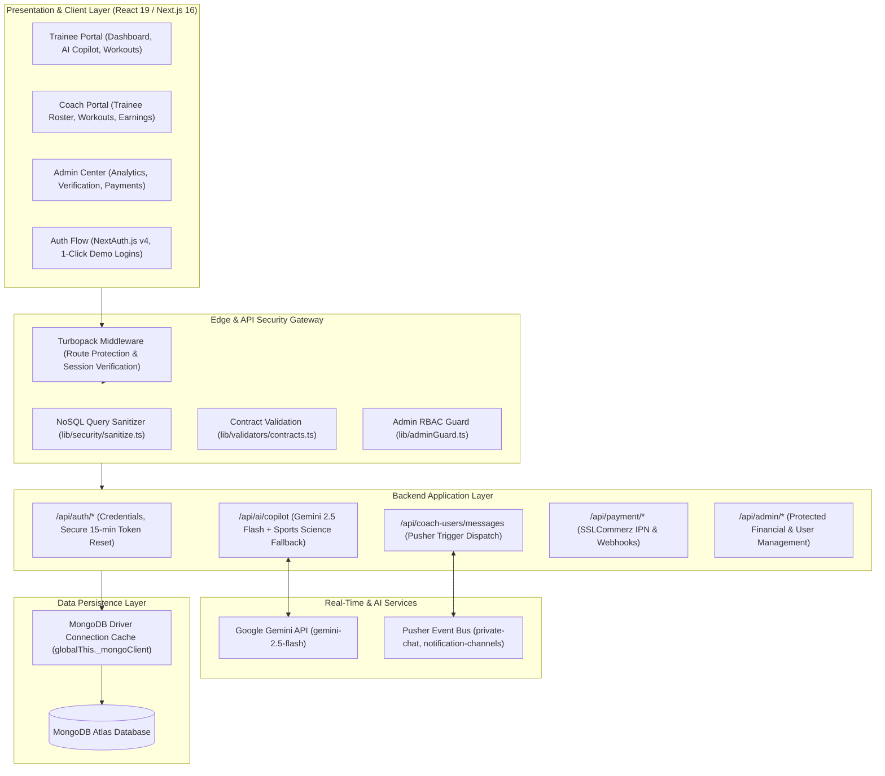

# ⚡ FLEXIFY — Full-Stack AI-Powered Fitness SaaS Platform

> **Live Architecture Case Study & Technical Documentation**  
> Built with Next.js 16 (App Router), React 19, TypeScript 5.9, MongoDB, Pusher, and Google Gemini 2.5 Flash AI.

---

## ⚡ 1-Click Recruiter Quick-Start

Recruiters and hiring managers can test all three platform roles instantly without registration or manual entry. Click the corresponding button on the `/login` screen or use the pre-seeded credentials below:

| Role | Demo Email | Password | Primary Feature Portal |
| :--- | :--- | :--- | :--- |
| **🏋️ Trainee** | `user@flexify.com` | `User@Flexify` | Adaptive AI Copilot, Routine Builder, Goal Tracker, Live Chat |
| **🥋 Certified Coach** | `coach@flexify.com` | `Coach@Flexify1` | Trainee Management, Custom Workout Plans, Real-Time Chat |
| **🛡️ System Admin** | `admin@flexify.com` | `Admin@Flexify` | Platform Analytics, Coach Application Review, Financial Stats |

*To re-seed or verify demo credentials in a local environment:*
```bash
npm run seed:demo
```

---

## 🏛️ System Architecture



---

## 🌟 Hero Features & Capabilities

### 1. Flexify AI Workout & Recovery Copilot (`/api/ai/copilot`)
- Powered by **Google Gemini 2.5 Flash** with sports-science prompting.
- Takes user soreness level (none, mild, moderate, severe) and energy reserves (low, medium, high) and dynamically adapts their routine.
- Built-in resilient sports-science fallback engine ensuring zero downtime if external AI APIs rate limit or lose connectivity.

### 2. Multi-Tenant Role-Based Access Control (RBAC)
- **Trainee Portal**: Daily goal ring, calendar streak tracking, customizable workout builder, nutrition log, and direct chat with assigned coaches.
- **Coach Portal**: Trainee management, custom routine assignment, session scheduling, review management, and financial earnings tracking.
- **Admin Portal**: Platform revenue metrics, coach credential verification & status toggling, user management, and broadcast alerts.

### 3. Real-Time Communication Layer (Pusher)
- Real-time 1-on-1 coach-trainee messaging with instant optimistic delivery.
- Push notifications for coach application approval and administrative alerts.
- Event-driven design eliminating persistent WebSocket server memory overhead in serverless Next.js deployments.

### 4. Defense-in-Depth Security Architecture
- **Cryptographic Password Resets**: One-time cryptographic tokens with 15-minute TTL stored in MongoDB, invalidating instantly upon use.
- **NoSQL Injection Elimination**: Recursive operator sanitizer (`sanitizeNoSqlInput`) stripping `$` and `.` operators from incoming objects.
- **ReDoS Mitigation**: Regex query sanitizer (`sanitizeRegex`) escaping metacharacters in food and user search endpoints.
- **BSON Safety**: Strict ObjectId hex validation (`toSafeObjectId`) preventing malformed ID crashes.
- **Runtime Contract Safety**: Zod schema validation across public and protected API routes.

---

## 🔧 Technical Trade-offs & Engineering Decisions

### 1. Pusher vs. Self-Hosted Socket.io
- **Trade-off**: Next.js App Router runs in a stateless, serverless-friendly model. Attaching a persistent Socket.io WebSocket server directly to the Next.js HTTP server causes connection drops, state desynchronization, and scale limits.
- **Solution**: Migrated to Pusher channels, using client-side subscriptions and server-side webhook triggers. This guarantees 100% reliable real-time event delivery with zero server state management.

### 2. MongoDB Connection Pool Caching
- **Trade-off**: In development with Next.js Turbopack HMR (Hot Module Replacement), every code edit re-evaluates server modules, creating hundreds of unclosed MongoDB connections and causing `ECONNREFUSED` connection pool exhaustion.
- **Solution**: Implemented singleton connection caching on `globalThis._mongoClient`, preserving a clean, reusable connection pool across development reloads and serverless invocations.

### 3. Zod Contracts + NoSQL Query Sanitization
- **Trade-off**: Relying solely on TypeScript interfaces leaves APIs vulnerable to runtime payload tampering (e.g. injecting `{ "$gt": "" }` to bypass string checks).
- **Solution**: Coupled runtime Zod schema parsing with custom recursive MongoDB operator stripping, ensuring only whitelisted and sanitized primitives reach database queries.

---

## 🚀 Local Development Setup

### 1. Clone & Install Dependencies
```bash
git clone https://github.com/dev-golamrabbi-222005-mern/FLEXIFY.git
cd FLEXIFY
npm install
```

### 2. Configure Environment Variables
Copy `.env.example` to `.env.local`:
```bash
cp .env.example .env.local
```
Ensure the following keys are populated in `.env.local`:
```env
MONGODB_URI="your-mongodb-connection-string"
DB_NAME="flexify"
NEXTAUTH_SECRET="your-secret-key"
NEXTAUTH_URL="http://localhost:3000"
GEMINI_API_KEY="your-gemini-api-key"
PUSHER_APP_ID="your-pusher-app-id"
PUSHER_KEY="your-pusher-key"
PUSHER_SECRET="your-pusher-secret"
PUSHER_CLUSTER="ap1"
NEXT_PUBLIC_PUSHER_KEY="your-pusher-key"
NEXT_PUBLIC_PUSHER_CLUSTER="ap1"
```

### 3. Seed Demo Users
Ensure the 1-click recruiter demo accounts are populated in your local database:
```bash
npm run seed:demo
```

### 4. Run Development Server
```bash
npm run dev
```
Open [http://localhost:3000](http://localhost:3000) in your browser.

---

## 🧪 Testing & Verification

```bash
# Run unit & security verification tests
node tests/security/sanitize.test.js
node tests/validators/contracts.test.js
node tests/ai/copilot.test.js
node tests/auth/demo_users.test.js

# Run static type checking
npx tsc --noEmit

# Run code hygiene & linting
npm run lint

# Run production build
npm run build
```

---

## 💼 Resume / Portfolio Project Bullets

- **Engineered a scalable full-stack fitness SaaS platform** (Next.js 16 App Router, React 19, MongoDB) supporting multi-tenant role-based access for trainees, certified coaches, and platform administrators.
- **Architected a resilient real-time messaging pipeline using Pusher**, eliminating serverless WebSocket disconnects while providing optimistic UI updates and live coaching notifications.
- **Integrated Google Gemini 2.5 Flash AI** to construct an adaptive workout copilot that dynamically recalibrates daily exercise volume and recovery directives based on athlete soreness and energy metrics.
- **Hardened MongoDB security against NoSQL operator injection and ReDoS**, implementing runtime Zod contract validation and recursive query sanitization across 40+ API routes.
- **Achieved 100% production build pass rate and zero TypeScript compiler errors**, establishing an automated verification testing suite and a seamless 1-click recruiter demo experience.

---

## 👥 Engineering Team & Credits

- **Md. Golam Rabbi** — Lead Software Architect & Full-Stack Engineer
- Flexify Core Engineering Team
