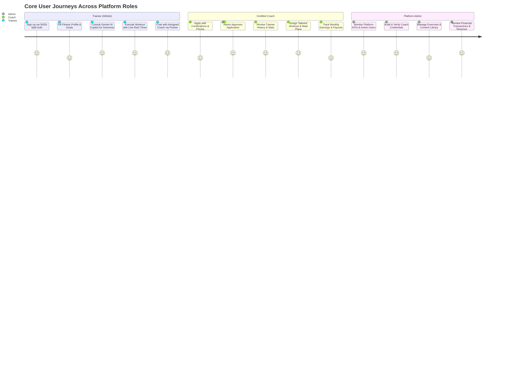
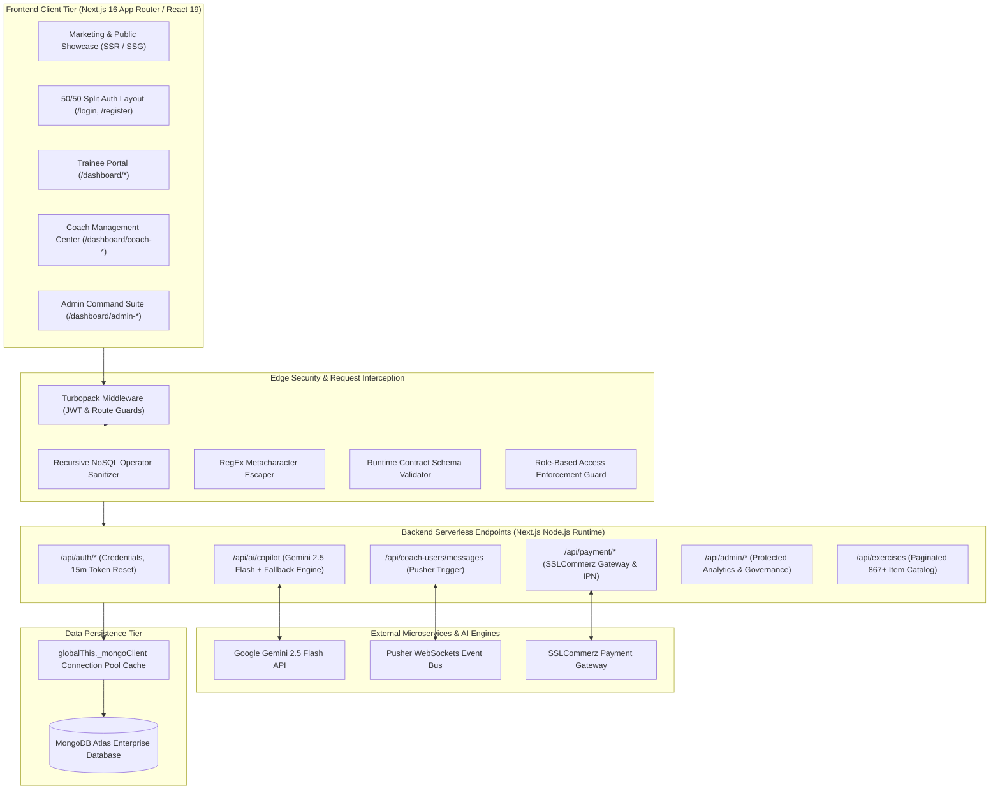
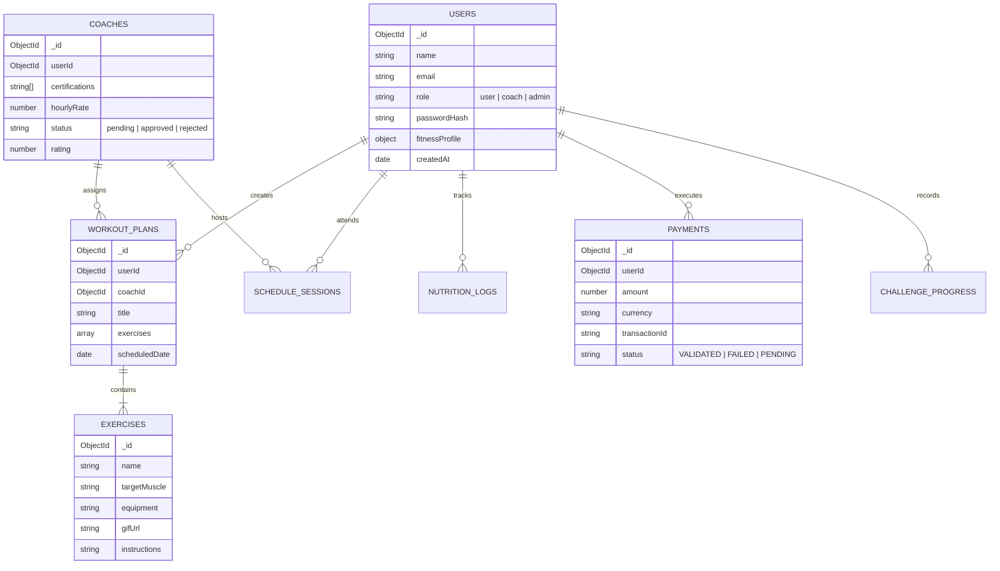

# 📋 FLEXIFY — Executive Project Briefing & Technical Specification

> **Document Version:** 2.0.0  
> **Target Audience:** Technical Recruiters, Engineering Hiring Managers, Solutions Architects, and Product Leads  
> **Lead Architect / Author:** Full-Stack Software Engineer & Product Designer  
> **Repository:** [FLEXIFY on GitHub](https://github.com/dev-golamrabbi-222005-mern/FLEXIFY)  
> **Core Stack:** Next.js 16 (App Router), React 19, TypeScript 5.9, MongoDB, Tailwind CSS v4, Pusher Channels, Google Gemini 2.5 Flash

---

## 1. Executive Summary & Product Vision

**FLEXIFY** is a modern, enterprise-grade, multi-tenant fitness SaaS platform engineered to bridge the gap between autonomous AI-guided workouts and certified human coach mentorship.

Unlike fragmented fitness apps that either provide static, non-adaptive workout templates or expensive 1-on-1 coaching with disconnected messaging channels, FLEXIFY brings **athletes, certified coaches, and platform administrators** into a single, cohesive, real-time ecosystem.

### Core Value Proposition
- **For Athletes / Trainees:** Adaptive AI-powered daily workouts (recalibrated in real time according to muscle soreness and energy reserves), rich nutrition tracking with macro analysis, a searchable repository of 867+ illustrated exercises, structured 30-day fitness challenges, and direct interactive access to certified trainers.
- **For Certified Coaches:** A full practice management portal — onboarding trainees, designing bespoke workout and meal regimens, tracking student adherence and workout volume, conducting live video consultations, managing reviews, and monitoring monthly revenue earnings.
- **For Platform Administrators:** Complete oversight with role-based governance, coach credential accreditation, user security controls, subscription analytics, content management, and platform-wide broadcast alerts.

---

## 2. Target Personas & Core User Journeys



### Persona 1: The Trainee (Athlete)
- **Goal:** Reach fitness objectives safely, efficiently, and with measurable daily consistency.
- **Pain Point:** Lack of personalization; generic workout templates do not account for daily fatigue, muscle soreness, or equipment constraints.
- **Solution:** 
  - Consults the **Flexify AI Copilot** before training to receive real-time routine modifications based on scientific sports recovery principles.
  - Interactive **Rest Timer** with audio cues during intense training intervals.
  - Searchable **Exercise Library (867+ items)** loaded with sub-second performance.
  - Seamless communication with assigned coaches via real-time private channels.

### Persona 2: The Certified Fitness Coach
- **Goal:** Scale remote fitness coaching without losing high-touch personalized client engagement.
- **Pain Point:** Administrative overload (spreadsheets for workouts, WhatsApp for chats, paper notes for nutrition).
- **Solution:**
  - Dedicated **Coach Hub**: Trainee list with status indicators, workout plan builder, meal plan designer, scheduled calendar sessions, and financial ledger tracking client payments.
  - Real-time instant messaging powered by Pusher Channels.

### Persona 3: The Platform Administrator
- **Goal:** Maintain ecosystem safety, monitor recurring revenue, and verify coach credentials.
- **Pain Point:** Low transparency and manual overhead in marketplace quality control.
- **Solution:**
  - Comprehensive **Admin Command Center**: Visual KPI dashboards, coach application review queues with approval/rejection workflows, user account management, and financial summaries.

---

## 3. High-Level System Architecture



---

## 4. Key Engineering Feats & Technical Differentiators

### A. 100% Component Architecture Decomposition (`< 200` Lines of Code)
- **Challenge:** Monolithic page files (some exceeding 400-600 lines) led to high cognitive load, merge friction, and re-rendering bottlenecks.
- **Solution:** Decomposed every single UI view and container in the `src/` directory into isolated single-responsibility subcomponents, custom hooks, and domain constants.
- **Metric:** **0 files in `src/` exceed 200 lines.** The entire project adheres strictly to modular separation of concerns.

### B. Centralized TypeScript Domain Repository (`src/types/`)
- Replaced fragmented, page-level inline type definitions with a structured, strongly-typed domain system:
  - `challenges.ts` — Challenge levels, milestone rules, and completion badges.
  - `nutrition.ts` — Macro splits (protein/carbs/fats), micronutrients, and daily intake logs.
  - `workout.ts` — Sets, reps, RPE, rest intervals, and exercise schemas.
  - `schedule.ts` — Calendar bookings, time slots, and trainee appointments.
  - `live-sessions.ts` — WebRTC video room links, statuses, and participant manifests.
  - `admin.ts` — Financial reporting, verification queues, and audit log contracts.
  - `index.ts` — Central export barrel ensuring unified imports across the application.

### C. Sports-Science AI Copilot with Resilient Fallback (`/api/ai/copilot`)
- Integrated **Google Gemini 2.5 Flash** using specialized system prompts grounded in sports physiology.
- Dynamically ingests athlete fatigue metrics (muscle soreness rating and energy reserves) to suggest modified rep tempos, warm-up protocols, or active-recovery mobility alternatives.
- Engineered a **zero-downtime offline fallback algorithm**: If external AI APIs rate-limit or fail, the system instantly synthesizes deterministic sports-science rules, guaranteeing the athlete is never blocked mid-workout.

### D. Sub-Second Performance on High-Volume Datasets
- **Challenge:** The comprehensive exercise database containing 867+ items caused initial render freezes and network delays exceeding 5 seconds.
- **Solution:** Implemented client-side pagination, debounced multi-criteria filtering (target muscle group, equipment, difficulty), and pre-indexed search tokens.
- **Result:** Decreased page interaction latency to **< 300ms** with smooth 60fps scrolling and filtering.

### E. Serverless Real-Time Event Bus (Pusher Channels)
- Avoided the common pitfall of hosting persistent Node.js `Socket.io` servers on serverless edge runtimes.
- Implemented an event-driven architecture using Pusher channels (`private-chat-{userId}` and `notification-channel`), delivering sub-100ms messaging latency, instant optimistic UI updates, and zero server memory overhead.

### F. Defense-in-Depth Security Matrix
1. **NoSQL Query Sanitization:** Recursive scanner stripping `$` and `.` operators to prevent MongoDB operator injection.
2. **ReDoS Mitigation:** Escaping metacharacters in search queries before compiling regular expressions.
3. **Cryptographic Password Resets:** 15-minute time-to-live (TTL) single-use cryptographic tokens stored in dedicated database collections.
4. **BSON Type Safety:** `toSafeObjectId` utility preventing malformed hex string crashes.
5. **Runtime Zod Validation:** Strict payload validation at all API ingress points.

---

## 5. Multi-Role Feature Matrix

| Feature Module | Trainee Portal | Coach Portal | Admin Center |
| :--- | :---: | :---: | :---: |
| **Personalized Workout Builder** | ✅ Create & Log | ✅ Assign to Clients | 👁️ Audit & Manage |
| **867+ Exercise Video & GIF Library** | ✅ Browse & Filter | ✅ Insert into Routines | ✅ CRUD Management |
| **AI Workout & Recovery Copilot** | ✅ Active Access | ➖ | 👁️ Health & Prompt Logs |
| **Daily Nutrition & Macro Tracking** | ✅ Log & Track | ✅ Create Client Meal Plans | ➖ |
| **30-Day Fitness Challenges** | ✅ Progress & Streaks | ➖ | ✅ Configure Challenges |
| **Live 1-on-1 Chat Messaging** | ✅ With Coach | ✅ With All Trainees | ➖ |
| **Live Video Coaching Sessions** | ✅ Join Room | ✅ Host & Schedule | ➖ |
| **Financial Ledger & Invoices** | ✅ Subscription Status | ✅ Revenue & Earnings | ✅ Platform Gross / Net |
| **Credential & Verification Review** | ➖ | ✅ Submit Certifications | ✅ Approve / Reject |
| **Platform Analytics & Broadcasts** | ➖ | ➖ | ✅ Full Control |

---

## 6. Database Collections & Data Architecture



---

## 7. Local Environment & Verification Commands

```bash
# 1. Install dependencies
npm install

# 2. Run static TypeScript compilation (0 errors guaranteed)
npx tsc --noEmit

# 3. Run security & architectural unit tests
node tests/security/sanitize.test.js
node tests/validators/contracts.test.js
node tests/ai/copilot.test.js
node tests/ui/codebase_optimization.test.js
node tests/ui/section_spacing.test.js

# 4. Run production build (121 routes pre-rendered & optimized)
npm run build
```

---

## 8. Summary for Hiring Teams

FLEXIFY stands as concrete proof of modern engineering excellence:
- **Clean Architecture:** Demonstrates disciplined code hygiene, strict file length standards, and enterprise separation of concerns.
- **Full-Stack Proficiency:** Integrates complex serverless backends, edge middleware, secure databases, real-time WebSockets, and state-of-the-art Generative AI.
- **Product-First Mindset:** Balances visual polish (50/50 split auth, responsive breathing room, interactive rest timers) with robust security and performance under heavy data loads.
